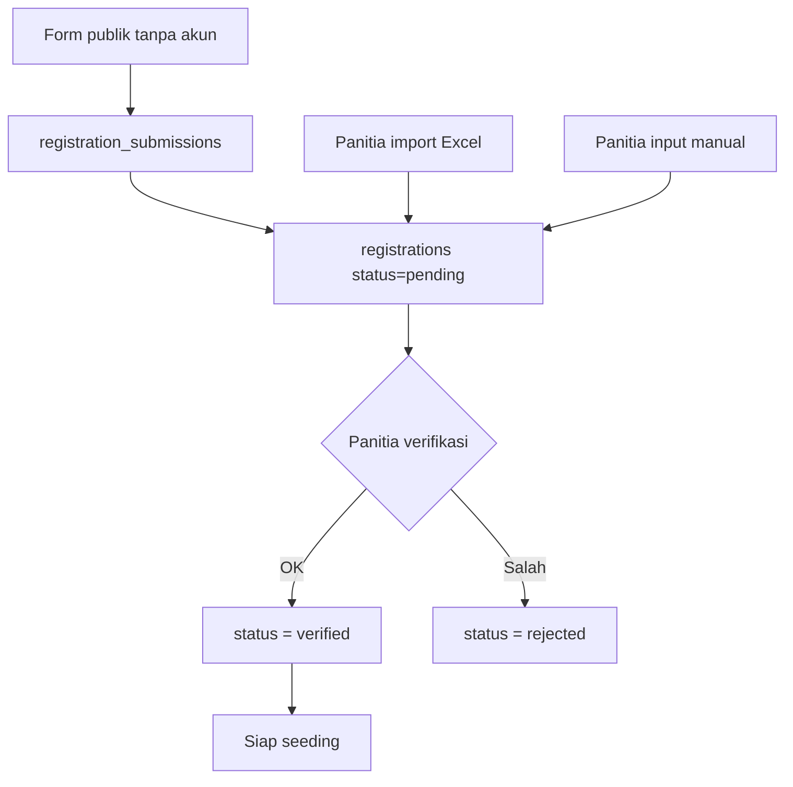

# 04 - Alur Pendaftaran (MVP, tanpa pembayaran)

## Tiga Jalur Masuk

Semua bermuara ke tabel `registrations`.

**Hanya status `verified` yang ikut seeding.** Tidak ada syarat lunas/tagihan.

## Form Publik

Form mengikuti kolom Excel peserta: nama lengkap, L/P, tahun lahir, klub/sekolah, kabupaten/kota. **Tidak ada** kolom terpisah untuk nama, telepon, atau email pendaftar; `registrant_name` diisi dari nama atlet.

1. Data atlet + **klub diketik sendiri** (nama klub + kabupaten/kota).
2. Pilih nomor lomba yang layak + seed time opsional (kosong = NT).
3. Kirim → kode `REG-…`. Pendaftar tidak mengedit lagi; koreksi lewat panitia.

Form hanya terbuka jika status kejuaraan `registration` **dan** waktu sekarang berada di antara `registration_opens_at` dan `registration_closes_at` (kolom kosong = tidak membatasi sisi itu).

Klub baru dari form masuk berstatus `pending` sampai panitia verifikasi. Nama klub yang sama dipakai ulang otomatis.

Proteksi: rate limit IP, honeypot.

## Import Excel

Template + validasi baris + pratinjau + commit. Rincian di [07-import-excel.md](07-import-excel.md).

## Input Manual Panitia

Panitia menambah atau mengubah pasangan atlet × nomor lomba dari admin tanpa lewat wizard publik. Dari form ini (atau dari antrean/detail entri) panitia juga dapat **menaikkan kelas** satu nomor: `registrations.age_group_id` diganti ke grup lebih tua, dengan alasan wajib, sementara tahun lahir atlet tetap. Form publik tidak menawarkan pilihan ini.

Panitia masih boleh menambah entri setelah status kejuaraan `closed`; import Excel dan form publik tidak.

## Verifikasi

Panitia menyetujui atau menolak entri. Setelah `verified`, entri masuk antrean seeding.

Entri `rejected` atau `withdrawn` tidak mengunci kuota dan tidak dihitung duplikat. Daftar ulang (publik, Excel, atau input manual) memakai baris yang sama dan mengembalikan status ke `pending`.

## Validasi Inti

Kode di bawah ini adalah kode yang dipakai `RegistrationValidator`.

| Kode | Aturan |
| --- | --- |
| V-01 | Status kejuaraan masih mengizinkan panitia menambah nomor (`registration` atau `closed`). Setelah seeding: nomor tidak bisa diubah |
| V-02 | Tahun lahir masuk tepat satu kelompok umur. Tumpang tindih grup juga V-02 |
| V-03 | Nomor diizinkan matriks kelompok umur (grup efektif, termasuk naik kelas) |
| V-04 | Nomor sesuai gender atlet |
| V-05 | Tidak dobel atlet × nomor yang masih aktif (`draft` / `pending` / `verified`) |
| V-06 | Jumlah nomor aktif ≤ batas per atlet |
| V-07 | Format seed time valid atau kosong (NT) |
| V-08 | Seed time dalam batas kewajaran untuk jarak itu |

Naik kelas (hanya panitia): grup tujuan harus lebih tua, tetap ada di matriks nomor itu, alasan wajib (V-10), turun kelas ditolak (V-09). Excel: `9*` ke grup lebih tua terdekat. Jejak audit: `registration.age_group_override`. Menu: **Naik kelas**.
